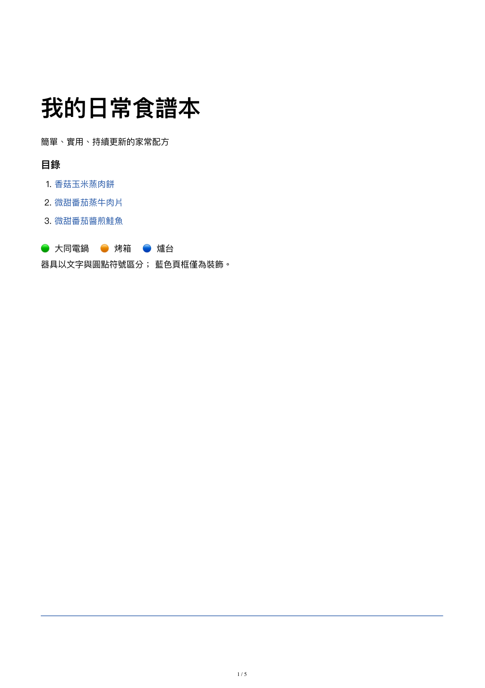

# My Cookbook

A personal cookbook written primarily in Traditional Chinese. Keep one recipe per Markdown file in `dishes/`; `build_cookbook.py` merges them into one PDF with a clickable table of contents. Original dish names and English ingredient names useful for shopping in Canada may be retained.

This README keeps no recipe list. The table of contents is generated from the recipe files on each build.



## Quick start

From the repository root:

```bash
python3 build_cookbook.py
```

Open `export/cookbook.pdf`. You need a working Python 3 with venv support. The first build creates `_support/.venv/`, installs Playwright, and downloads Chromium, requiring network access. Later builds reuse the environment and existing browser installation; setup can need network again if dependencies or browser files are missing.

## Everyday use and ordering

1. Read `_support/AI_INSTRUCTIONS.md`, the authoritative recipe specification.
2. Copy `_support/TEMPLATE.md` into `dishes/`. It is the rice-cooker starter; for a stove or oven recipe, use the corresponding template in the instructions, including cooking time.
3. Name a new file with the current highest numeric prefix plus one, for example `008-菜名.md` after `007`. Never backfill gaps, reuse deleted numbers, or renumber existing recipes.
4. Fill in the recipe, removing placeholders and inapplicable sections. Keep the in-file title unnumbered.
5. Rebuild after editing. Changes are not exported automatically.

Edit an existing recipe in place, preserving its number. Do not add trial logs, date fields, or duplicate versions. Keep one dish per file and no recipe subfolders; list all necessary appliances in the same recipe.

For a writing preview in VS Code, use `Cmd + Shift + V` on macOS or `Ctrl + Shift + V` on Windows and Linux.

## Recipe rules and AI editing

- Write primarily in Traditional Chinese; retain original dish names and Canadian shopping ingredient names when useful.
- Include appliance, servings, applicable time fields, and status. Rice-cooker recipes list preparation time only; stove/oven recipes also list cooking time. List necessary waiting separately.
- No garlic, scallion, or shallot by default. Onion may be used only as large removable pieces, removed and discarded after cooking.
- Keep confirmed cooking feedback distinct from untested adjustments. Preserve relevant doneness checks and sources.
- Explore relevant languages when finding recipes, not only English and Chinese; follow the full discovery and flavor preferences in `_support/AI_INSTRUCTIONS.md`.
- Supported recipe Markdown: headings, paragraphs, single-level lists, bold, inline code, and HTTP(S) links. Do not use tables, images, nested lists, fenced code blocks, raw HTML, or manual page breaks inside recipes.

`AGENTS.md` is the repository entry point for AI tools that support it and points to `_support/AI_INSTRUCTIONS.md`. Tool-specific instruction loading varies; ensure your agent reads these files. When editing an existing recipe, name the file and have the agent read it first.

## Output and verification

Each full build writes:

- `export/cookbook.md`: merged recipes and a generated text table of contents.
- `export/cookbook.html`: browser-readable cookbook with linked contents; PDF pagination and footers are print-specific.
- `export/cookbook.pdf`: cover and clickable contents, page numbers, and each recipe starting on a new page. Long recipes may continue onto additional pages.

Generated output and `_support/.venv/` are gitignored. Do not edit or force-add generated output. The README preview is a committed screenshot, not a live rendering.

```bash
python3 build_cookbook.py --merge-only
```

This checks whether recipe loading and Markdown/HTML generation complete without using the venv or Playwright. It is not a recipe-specification validator: success does not certify numbering, required fields, supported syntax, safety, or PDF layout. Unsupported Markdown may be flattened or rendered as text rather than rejected.

If PDF output is stale, rebuild. If a full build fails, `--merge-only` can help isolate the loading/conversion stage from environment/browser problems, but it is not a complete diagnosis. For Playwright/Chromium errors, check the reported error and network before retrying. `--render` is an internal second pass, not the normal entry point.

Layout, CSS, frame, contents, and pagination belong in `build_cookbook.py`, not individual recipes. Header fields on consecutive lines are rendered as separate paragraphs. After renderer changes, run the full build and inspect the PDF before claiming layout success. Refresh `docs/preview.png` if the visible layout changes.

## Structure

```text
.
├── README.md
├── AGENTS.md
├── LICENSE
├── dishes/
├── build_cookbook.py
├── docs/preview.png
├── export/              generated, gitignored
└── _support/
    ├── AI_INSTRUCTIONS.md
    ├── TEMPLATE.md
    ├── requirements.txt
    └── .venv/           generated, gitignored
```

## License

MIT — see `LICENSE`.

---

# 我的食譜

以繁體中文為主的個人食譜本；必要時保留原文菜名及加拿大購物用的英文食材名稱。每道菜放在 `dishes/` 的一個 Markdown 檔，由腳本合併成有可點選目錄的 PDF。README 不維護個別食譜清單。


## 快速開始

在 repo 根目錄執行：

```bash
python3 build_cookbook.py
```

開啟 `export/cookbook.pdf`。需要可用且支援 venv 的 Python 3。首次建置會建立 `_support/.venv/`、安裝 Playwright 並下載 Chromium，需要網路；之後沿用環境與已安裝的瀏覽器，若相依套件或瀏覽器檔案遺失，仍可能需要網路重新準備。

## 日常使用與順序

1. 先讀主要規格 `_support/AI_INSTRUCTIONS.md`。
2. 複製 `_support/TEMPLATE.md` 到 `dishes/`。這是電鍋起始範本；爐台或烤箱食譜請使用主要指引中的對應範本，列出烹調時間。
3. 新檔使用現有最大編號的下一號，例如 `007` 之後用 `008-菜名.md`。不補空缺、不重複使用刪除過的編號、不重新編號。
4. 填妥食譜，刪除佔位內容及不適用的節；檔內標題不加編號。
5. 修改後重新建置；不會自動匯出。

既有食譜就地修改並保留原編號，不加入試做日誌、日期欄或重複版本。一般不建食譜子資料夾；多器具料理仍只保留一份，列出所有必要器具。

VS Code 寫作預覽：macOS 使用 `Cmd + Shift + V`，Windows／Linux 使用 `Ctrl + Shift + V`。

## 食譜規則與 AI 編輯

- 以繁體中文為主，必要時保留原文菜名及英文食材名稱。
- 列出器具、份量、適用時間及狀態。電鍋只列準備時間；爐台／烤箱另列烹調時間；必要等待另外列出。
- 預設不用蒜、青蔥或紅蔥頭。洋蔥僅可用方便取出的大塊，烹調後取出丟棄。
- 區分已確認回饋與未實測調整，保留適用熟度判斷及來源。
- 搜尋食譜時依料理探索相關語言，不限中英文；完整選菜與風味偏好以主要指引為準。
- 食譜 Markdown 僅使用標題、段落、單層清單、粗體、行內程式碼及 HTTP(S) 連結；不要加入表格、圖片、巢狀清單、程式碼區塊、原始 HTML 或手動分頁。

`AGENTS.md` 是支援此慣例的 AI 工具入口，指向 `_support/AI_INSTRUCTIONS.md`；不同工具的自動載入方式有差異，應確認工具有讀取這兩份文件。修改既有食譜前，先讓 AI 讀取對應檔案。

## 輸出與檢查

完整建置產生：

- `export/cookbook.md`：合併食譜及自動文字目錄。
- `export/cookbook.html`：可用瀏覽器閱讀，目錄可點選；PDF 的分頁與頁尾屬列印行為。
- `export/cookbook.pdf`：封面、可點選目錄、頁碼；每道食譜從新頁開始，長食譜可續頁。

產出與 `_support/.venv/` 已 gitignore；不要手改或強制加入產出。README 預覽圖是已提交截圖，不是即時渲染。

```bash
python3 build_cookbook.py --merge-only
```

此模式不使用 venv 或 Playwright，只檢查食譜讀取及 Markdown／HTML 產生流程能否完成，不是食譜規格驗證器。成功不代表編號、必填欄位、語法、安全或 PDF 排版已通過檢查；不支援的 Markdown 可能被壓平或顯示為文字，不一定報錯。

PDF 沒更新就重新建置。完整建置失敗時，可用 `--merge-only` 協助區分讀取／轉換階段與環境／瀏覽器問題，但不能據此完成診斷。Playwright／Chromium 出錯時，先看錯誤與網路狀態再重試。`--render` 是內部第二階段，不是一般入口。

版面、CSS、頁框、目錄與分頁由 `build_cookbook.py` 控制，不放進食譜。連續行的食譜資訊欄會各自渲染為獨立段落。修改渲染器後須完整建置並檢查 PDF，才能宣稱版面成功；可見排版改變時應更新 `docs/preview.png`。資料夾結構見上方 Structure；授權為 MIT，見 `LICENSE`。
