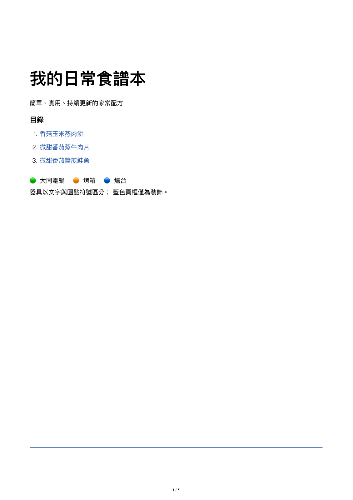

# My Cookbook

A personal Traditional-Chinese cookbook. One dish per Markdown file in `dishes/`;
one Python script turns them into a single PDF with a clickable table of contents.

This file keeps no recipe list — the PDF's table of contents is generated from
the filenames in `dishes/` on every build.



## Quick start

From the repo root:

```bash
python3 build_cookbook.py
```

Then open `export/cookbook.pdf`.

You need a working Python 3. The first build is slow: the script creates
`_support/.venv/`, installs Playwright, and downloads Chromium. That needs
network access once. Later builds reuse all of it.

## Everyday use

Add a dish:

1. Copy `_support/TEMPLATE.md` into `dishes/`.
2. Name it with the next free number, for example `004-菜名.md`.
3. Fill in the template. The title inside the file has no number.
4. Rebuild and it appears in the PDF.

Edit a dish:

1. Open that file in `dishes/`.
2. Change it in place — no dates, no history, no second copy.
3. Rebuild.

To see the Markdown while writing, use the VS Code preview:
`Cmd + Shift + V` on macOS, `Ctrl + Shift + V` on Windows and Linux.

## Filenames and order

Recipes are sorted by relative filename, so the numeric prefix is the PDF order.

- Three digits: `001-香菇玉米蒸肉餅.md`.
- A new recipe takes the next free number, so it lands at the end.
- After deleting a dish, never renumber the others or reuse the number.
- The title inside the file carries no number: `# 香菇玉米蒸肉餅`.

## Recipe content

- Traditional Chinese only.
- One dish per file, no subfolders. A dish that uses several appliances still
  gets one file; list the appliances inside it.
- Every recipe starts with `器具`, `份量`, a time field, and `狀態`.
- House preferences: no garlic, no scallion or shallot; onion only as large
  pieces that are taken out and discarded after cooking.

`_support/AI_INSTRUCTIONS.md` is the full spec: template, timing rules,
appliance labels, and the supported Markdown subset. Visitors adapting this
for themselves should change those preferences there, not in the script.

## Editing with AI

Agents that read repo instructions (OpenCode, Claude Code, Cursor, and similar)
load `AGENTS.md` automatically, and it points to `_support/AI_INSTRUCTIONS.md`
for the full rules. When editing an existing recipe, name the file so the agent
reads it; the guide does not need to be pasted in full.

## Output files

Each build writes three files under `export/`:

| File | Use |
| --- | --- |
| `export/cookbook.pdf` | the cookbook: cover TOC, one recipe per page |
| `export/cookbook.html` | same layout, quick to open in a browser |
| `export/cookbook.md` | all recipes merged into plain Markdown |

These are generated, so they are gitignored and not in the repo. The screenshot
above comes from a real build. Do not edit them by hand — rebuild instead.

## If something goes wrong

- New PDF missing your changes: the build does not watch files. Run
  `python3 build_cookbook.py` again.
- Build fails: run `python3 build_cookbook.py --merge-only`. It rebuilds the
  Markdown and HTML without touching the venv or Playwright, which tells you
  whether the problem is a recipe or the browser.
- Playwright or Chromium error: check the network and run it again; the setup
  step is retried.

## Technical details

- `--merge-only` — Markdown and HTML only, never touches `_support/.venv/`.
- `--render` — internal second pass used by the build; do not call it directly.
- Layout, CSS, page frame, TOC, and pagination live only in `build_cookbook.py`.
  Keep recipes as plain Markdown.
- Supported in recipes: headings, paragraphs, single-level lists, `**bold**`,
  `` `inline code` ``, `[links](https://…)`. Tables, images, nested lists, code
  blocks, raw HTML, and manual page breaks are not — the renderer flattens or
  drops them.

```text
.
├── README.md
├── AGENTS.md
├── LICENSE
├── dishes/              recipes, one file per dish
├── build_cookbook.py    renderer and PDF export
├── docs/preview.png     screenshot used by this README
├── export/              generated, gitignored
└── _support/
    ├── AI_INSTRUCTIONS.md
    ├── TEMPLATE.md
    ├── requirements.txt
    └── .venv/           generated, gitignored
```

## License

MIT — see `LICENSE`.

---

# 我的食譜

一本個人的繁體中文食譜。一道菜一個 Markdown 檔案，放在 `dishes/`；
一支 Python 腳本把它們排成一本有可點選目錄的 PDF。

這份 README 不維護食譜清單——PDF 的目錄每次建置時，
由 `dishes/` 裡的檔名產生。


## 快速開始

在 repo 根目錄執行：

```bash
python3 build_cookbook.py
```

然後打開 `export/cookbook.pdf`。

電腦需要可用的 Python 3。第一次建置比較久：
腳本會建立 `_support/.venv/`、安裝 Playwright、下載 Chromium，
需要一次網路連線。之後會沿用，不會重新下載。

## 日常使用

新增一道菜：

1. 複製 `_support/TEMPLATE.md` 到 `dishes/`。
2. 檔名用下一個空號，例如 `004-菜名.md`。
3. 照範本填寫，檔內標題不加編號。
4. 重新建置，PDF 就會出現。

修改一道菜：

1. 直接打開 `dishes/` 裡那個檔案。
2. 就地修改，不寫日期、不留版本、不另存新檔。
3. 重新建置。

寫的時候想先看樣子，用 VS Code 的 Markdown 預覽：
macOS 按 `Cmd + Shift + V`，Windows 與 Linux 按 `Ctrl + Shift + V`。

## 檔名與順序

PDF 依相對檔名排序，所以檔名前面的編號就是 PDF 裡的順序。

- 三位數：`001-香菇玉米蒸肉餅.md`。
- 新食譜用下一個空號，自然排在最後。
- 刪除食譜後不重新編號，也不補回空號。
- 檔內標題不含編號：`# 香菇玉米蒸肉餅`。

## 食譜內容

- 一律使用繁體中文。
- 一道菜一個檔案，不開子資料夾。多器具的菜仍是一個檔案，
  器具列在內容裡。
- 每份食譜開頭要有 `器具`、`份量`、時間欄位與 `狀態`。
- 家裡口味：不加蒜、不加蔥與紅蔥頭；洋蔥只放可整塊撈起丟棄的大塊。

完整規格在 `_support/AI_INSTRUCTIONS.md`：範本、時間規則、器具標籤
與支援的 Markdown 範圍。若想改成自己的做法，
請改那份文件裡的偏好，不要改腳本。

## 用 AI 編輯

會讀取 repo 指示的 AI 工具（OpenCode、Claude Code、Cursor 等）
會自動載入 `AGENTS.md`，再由它指向 `_support/AI_INSTRUCTIONS.md`
取得完整規則。修改既有食譜時，把檔名告訴 AI，讓它讀那一個檔案即可，
不需要整份貼上。

## 輸出檔案

每次建置會在 `export/` 產生三個檔案：

| 檔案 | 用途 |
| --- | --- |
| `export/cookbook.pdf` | 整本食譜：封面目錄、每道菜一頁 |
| `export/cookbook.html` | 相同排版，用瀏覽器快速看 |
| `export/cookbook.md` | 全部食譜合併的純 Markdown |

這些是產出，所以被 gitignore、不在 repo 裡；上面那張圖就是實際建置的結果。
不要手動編輯，重新建置即可。

## 遇到問題

- PDF 沒有更新：建置不會監看檔案，改完要再執行
  `python3 build_cookbook.py`。
- 建置失敗：改跑 `python3 build_cookbook.py --merge-only`。
  它只重建 Markdown 與 HTML，不碰 venv 與 Playwright，
  可以用來分辨是食譜問題還是瀏覽器問題。
- Playwright 或 Chromium 出錯：確認有網路後再執行一次，
  安裝步驟會重試。

## 技術細節

- `--merge-only`：只產生 Markdown 與 HTML，完全不碰 `_support/.venv/`。
- `--render`：建置流程內部使用的第二階段，不要直接呼叫。
- 版面、CSS、頁框、目錄與分頁只存在於 `build_cookbook.py`。
  食譜保持純 Markdown。
- 食譜支援：標題、段落、單層清單、`**粗體**`、`` `行內程式碼` ``、
  `[連結](https://…)`。表格、圖片、巢狀清單、程式碼區塊、原始 HTML
  與手動分頁不支援，渲染器會忽略或壓平。

```text
.
├── README.md
├── AGENTS.md
├── LICENSE
├── dishes/              食譜，一道菜一個檔案
├── build_cookbook.py    排版與 PDF 匯出
├── docs/preview.png     給這份 README 用的截圖
├── export/              產出，已 gitignore
└── _support/
    ├── AI_INSTRUCTIONS.md
    ├── TEMPLATE.md
    ├── requirements.txt
    └── .venv/           產出，已 gitignore
```

## 授權

MIT，見 `LICENSE`。
